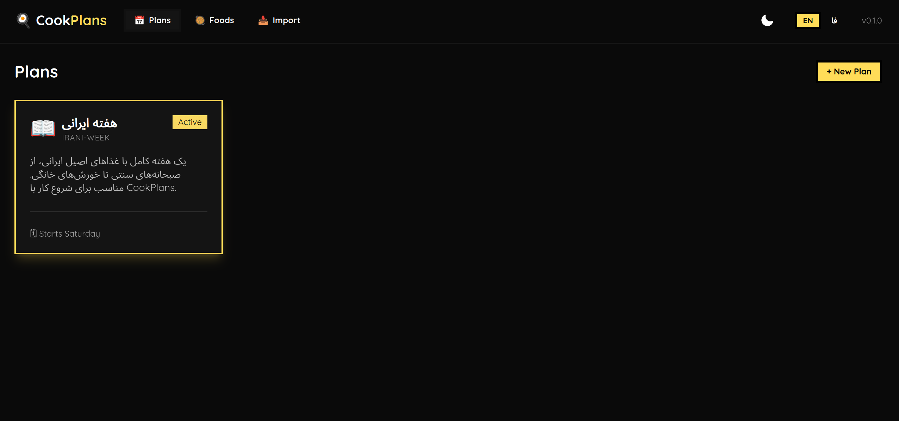

# 🍳 CookPlans



> Weekly smart cooking planner with step-by-step notifications — so every meal is ready exactly when you want it.

CookPlans is a cross-platform desktop app that helps you plan a week of meals, calculates the exact minute each cooking step should begin, and fires a native notification when it's time. Built with Tauri 2, Rust, and React.

---

## ✨ Features

- **Weekly plans** — each plan is a full week of meals. Start the week on any day (Saturday for Iran, Monday for the US, etc.).
- **Multiple meals per day** — breakfast, lunch, dinner, and snacks can all live on the same day, each with its own deadline.
- **One food per meal** — a meal is a single dish. Want pasta *and* chicken? That's two meals.
- **Reusable foods with steps** — every food defines its duration range (`minDuration` / `maxDuration`) and any number of ordered cooking steps with an `offsetTime` (minutes from when cooking starts).
- **Smart scheduling** — given a meal's ready time, the app computes `startedAt = deadlineAt − food.maxDuration` and schedules each step's notification at `startedAt + step.offsetTime`.
- **Native notifications** — a Rust scheduler ticks every 30 s and fires OS notifications for any step that becomes due.
- **JSON import bundles** — bulk-load plans, foods, and meals via a versioned JSON schema. Includes an AI helper guide you can copy into any agent.
- **Bilingual UI** — English (LTR) and Persian/Farsi (RTL), with the correct font swapped automatically (`Quicksand` for Latin, `Mikhak` for Persian).
- **Neo-Brutalism theme** — thick black borders, hard offset shadows, bright accent colors. Includes a light/dark toggle persisted to `localStorage`.
- **Default starter content** — a fully-populated Iranian week (عدسی، قورمه سبزی، فسنجان، چلوکباب کوبیده، …) is seeded on first launch so the app is useful immediately.

---

## 🧱 Tech stack

| Layer | Choice |
|---|---|
| Framework | **Tauri 2** (Rust backend + system WebView) |
| Frontend | **React 18** + **TypeScript** + **Vite** |
| Styling | **Tailwind CSS 4** + **DaisyUI 5** (custom `neobrutalism` / `neobrutalism-dark` themes) |
| State | React Context (`I18nProvider`, `ConfirmProvider`) + local component state |
| Database | **SQLite** (via `rusqlite` with bundled SQLite, no external dependency) |
| Notifications | `tauri-plugin-notification` driven by a custom Rust scheduler |
| Fonts | `Quicksand` (Latin) · `Mikhak` (Persian/Arabic) |

---

## 📋 Prerequisites

- **Node.js** 20+ and **pnpm** / **npm** / **bun**
- **Rust** (stable) via [rustup](https://rust-lang.org/tools/install)
- **Tauri system dependencies** for your OS:
  - **Linux:** `libwebkit2gtk-4.1-dev libappindicator3-dev librsvg2-dev patchelf`
  - **macOS:** Xcode Command Line Tools
  - **Windows:** MSVC Build Tools + WebView2 (preinstalled on Win 10/11)

See the [official Tauri prerequisites](https://tauri.app/start/prerequisites/) for exact per-distro commands.

---

## 🚀 Getting started

```bash
# 1. Clone
git clone <your-repo-url> cookplans
cd cookplans

# 2. Install JS dependencies
npm install

# 3. Add fonts (see below)

# 4. Run the real app (Rust backend + WebView)
npm run tauri dev
```

> ⚠️ `npm run dev` alone only starts Vite and shows a "Browser preview mode" page — `invoke()` calls need the Tauri window. Always use `npm run tauri dev` for actual work.

### 🅰️ Adding the fonts

Drop these four files into `src/assets/fonts/`:

| File | Source |
|---|---|
| `Quicksand-Regular.ttf` | [Google Fonts – Quicksand](https://fonts.google.com/specimen/Quicksand) |
| `Quicksand-Bold.ttf` | Same download |
| `Mikhak-Regular.woff2` | [rastikerdar/mikhak-font releases](https://github.com/rastikerdar/mikhak-font/releases) |
| `Mikhak-Bold.woff2` | Same release |

Without them the app still runs (system fallback), but `npm run tauri build` will fail. See `src/assets/fonts/README.md` for a CDN alternative.

---

## 📜 npm scripts

| Script | What it does |
|---|---|
| `npm run dev` | Vite dev server only (no Rust, no DB) |
| `npm run tauri dev` | **Full app** — Vite + Rust + SQLite + notifications |
| `npm run build` | TypeScript check + Vite production bundle |
| `npm run tauri build` | Produce installers for your OS |

After `npm run tauri build`, find installers under `src-tauri/target/release/bundle/`:
- **Windows:** `.msi` / NSIS `-setup.exe`
- **macOS:** `.dmg` + `.app`
- **Linux:** `.deb`, `.rpm`, `.AppImage`

---

## 🗺️ Project structure

```
cookplans/
├── src/                              # React frontend
│   ├── assets/fonts/                 # Quicksand + Mikhak (add manually)
│   ├── components/
│   │   ├── ConfirmDialog.tsx         # Global promise-based confirm()
│   │   ├── FoodDetailView.tsx        # Food page + step CRUD
│   │   ├── FoodFormModal.tsx
│   │   ├── FoodsView.tsx             # Mosaic grid of foods
│   │   ├── ImportView.tsx            # JSON import + AI guide copy
│   │   ├── PlansView.tsx             # Plan list + plan detail
│   │   ├── StepFormModal.tsx
│   │   ├── ThemeToggle.tsx
│   │   └── WeekView.tsx              # Day selector + meals + countdown
│   ├── lib/
│   │   ├── aiGuide.ts                # Embedded AI_IMPORT_GUIDE content
│   │   ├── api.ts                    # Typed invoke() wrappers
│   │   ├── i18n.tsx                  # Locale provider + formatTime()
│   │   ├── tauri.ts                  # isTauri() helper
│   │   ├── types.ts                  # Shared TS types + time helpers
│   │   └── useTheme.ts               # Theme toggle persistence
│   ├── locales/{en,fa}.json          # All user-facing strings
│   ├── App.tsx                       # Shell: header, nav, routing
│   ├── index.css                     # Tailwind + DaisyUI themes + fonts
│   └── main.tsx                      # Providers + root render
│
├── src-tauri/                        # Rust backend
│   ├── src/
│   │   ├── commands/
│   │   │   ├── foods.rs              # CRUD for foods and steps
│   │   │   ├── import.rs             # JSON import in one transaction
│   │   │   ├── meals.rs              # CRUD for meals + week details
│   │   │   ├── plans.rs              # CRUD for plans
│   │   │   └── schedule.rs           # Pure scheduling calc for previews
│   │   ├── db.rs                     # SQLite migrations (v1 + v2)
│   │   ├── lib.rs                    # Builder, plugins, invoke_handler
│   │   ├── models.rs                 # Serde structs shared with TS
│   │   ├── scheduler.rs              # Notification ticker
│   │   ├── seed.rs                   # First-launch seed loader
│   │   └── main.rs                   # Entry point
│   ├── seed.json                     # Default Iranian week
│   ├── capabilities/default.json     # Tauri permission grants
│   ├── tauri.conf.json
│   └── Cargo.toml
│
├── AI_IMPORT_GUIDE.md                # Same guide as lib/aiGuide.ts
└── package.json
```

---

## 🧮 Data model

```
plans ─┐
       │  (plan_id, weekday)             meals ──→ foods
       └── plan_meals ────────────────→  (1 food per meal)
                                          │
                                          └── food_steps (ordered by offset_time)
```

| Table | Key columns |
|---|---|
| `plans` | `name, slug UNIQUE, is_active, start_weekday` |
| `foods` | `name, slug UNIQUE, min_duration, max_duration` |
| `food_steps` | `food_id, name, duration, min_duration, max_duration, offset_time` |
| `meals` | `name, type ∈ {breakfast,lunch,dinner,snack}, deadline_at, started_at, food_id` |
| `plan_meals` | pivot: `plan_id, meal_id, weekday (0..6)` — no uniqueness constraint |

**Time convention:** all times are **integer minutes from midnight** (`420` = 7:00 AM, `1140` = 7:00 PM). Durations and offsets are also minutes.

**Scheduling formula:**
```
meal.started_at  = meal.deadline_at − food.max_duration
step.start_at    = meal.started_at + step.offset_time
step.end_at      = step.start_at   + step.duration
```

---

## 📥 Importing plans (JSON)

Open the **Import** tab, click **📋 Copy AI Guide**, paste it into your AI agent, and paste the resulting JSON back. The schema is documented in `AI_IMPORT_GUIDE.md`.

Minimal example:

```json
{
  "plans": [
    { "name": "My Week", "slug": "my-week", "isActive": true, "startWeekday": 6 }
  ],
  "foods": [
    {
      "name": "Omelette", "slug": "omelette",
      "minDuration": 6, "maxDuration": 10,
      "steps": [
        { "name": "Whisk", "duration": 2, "minDuration": 1, "maxDuration": 3, "offsetTime": 0 },
        { "name": "Cook",  "duration": 6, "minDuration": 4, "maxDuration": 8, "offsetTime": 2 }
      ]
    }
  ],
  "meals": [
    { "planSlug": "my-week", "weekday": 1, "name": "Monday Omelette",
      "mealType": "breakfast", "deadlineAt": 480, "foodSlug": "omelette" }
  ]
}
```

**Import behaviour:**
- Plans/foods with an existing `slug` are **skipped** (not updated).
- Meals duplicate by `(planSlug, weekday, name)` are **skipped** with a warning.
- Invalid `mealType` or out-of-range `weekday` are **skipped** with a warning.
- The whole batch runs in **one transaction**.

---

## 🔔 Notifications

- `tauri-plugin-notification` is registered in `lib.rs` and permission is granted in `capabilities/default.json`.
- A Rust scheduler (`src-tauri/src/scheduler.rs`) wakes every 30 s and, for the **active plan's current weekday**, checks each step's `start_at` against the current minute. Matching steps fire a notification (`meal · food · step`) and are deduplicated per day.
- Notifications only trigger when the OS grants the notification permission and the app is running (foreground or background tray).

---

## 🎨 Theming

Two DaisyUI themes are defined in `src/index.css`:

- `neobrutalism` — off-white base, black text, yellow primary, cyan secondary, coral accent.
- `neobrutalism-dark` — inverted lightness, same hues.

Neo-Brutalism conventions enforced in `@layer base`:
- All `.card / .btn / .input / .select / .textarea / .modal-box / .alert / .badge` get `border: 3px solid var(--color-base-content)`.
- Cards, modals, and buttons get a `6px 6px` hard shadow; inputs get `4px 4px`.
- `border-radius: 0` across the board.
- Shadows and borders use `--color-base-content` so they auto-flip between black and white when the theme toggles.

Toggle state is stored under `localStorage['cookplans.theme']`.

---

## 🌐 Localization

All user-facing text lives in `src/locales/en.json` and `src/locales/fa.json`. The `I18nProvider`:
- Sets `<html lang>` and `<html dir>` based on the active locale (RTL for `fa`).
- Swaps the `font-family` to `Mikhak` when `lang` is `fa` or `ar`.
- Exposes `t(key, vars)`, `weekdayName(day)`, `weekdayShortName(day)`, `formatTime(minutes)`.

Locale choice is persisted under `localStorage['cookplans.locale']`.

---

## 🚀 Getting started

### Prerequisites

- **Node.js** ≥ 18 and **pnpm/npm**
- **Rust** ≥ 1.77 (`rustup`)
- **Tauri CLI** v2: `cargo install tauri-cli --version "^2"`
- Android toolchain (only if building for Android):
  - Android Studio + SDK (API 24+)
  - NDK
  - `ANDROID_HOME` / `NDK_HOME` set

See [Tauri's Android guide](https://tauri.app/start/prerequisites/) for the full setup.

### Install & run (desktop dev)

```bash
git clone https://github.com/<you>/cookplans.git
cd cookplans
pnpm install
pnpm tauri dev
```

### Run on Android

```bash
pnpm tauri android init        # first time only
pnpm tauri android dev         # dev build on connected device/emulator
pnpm tauri android build       # release APK/AAB
```

> ⚠️ **Don't open the Vite dev server directly in a browser** — you'll get a friendly notice, not the app. CookPlans depends on the Tauri bridge for its entire data layer. Always use `pnpm tauri dev`.

### Build for release

```bash
pnpm tauri build                        # desktop
pnpm tauri android build --apk          # Android APK
```

---


## 🛠️ Development tips

- **Rust changes** require the dev server to recompile — first build is slow, incremental is fast.
- **Check Rust quickly** without launching the app: `cargo check --manifest-path=src-tauri/Cargo.toml`.
- **Reset the database** (fresh seed): delete the SQLite file at:
  - Linux: `~/.local/share/com.cookplans.app/cookplans.db`
  - macOS: `~/Library/Application Support/com.cookplans.app/cookplans.db`
  - Windows: `%APPDATA%\com.cookplans.app\cookplans.db`
- **Theme not applying** after edits? Hard-reload the WebView (`Ctrl+R` / `Cmd+R`) — Vite CSS HMR sometimes caches `@plugin` blocks.

---

## 🐛 Known issues

- **Linux Snap VS Code** — running `npm run tauri dev` from a Snap-installed VS Code terminal fails with `symbol lookup error: libpthread.so … __libc_pthread_init`. Fix documented in `.vscode/settings.json` (unsets `GTK_PATH` / `GIO_MODULE_DIR`) or install VS Code as `.deb`.
- **Fonts missing** — `npm run tauri build` aborts if any `url()` in `index.css` points to a missing file. Add the four font files to `src/assets/fonts/` before building installers.
- **Desktop notifications** rely on OS permission and the app being alive. If the window is closed without a tray process, the scheduler cannot fire.

---

## 🤝 Contributing

1. Fork, branch (`feat/your-thing`), and open a PR.
2. Match the existing code style: typed `api.*` wrappers, provider-driven state, DaisyUI primitives.
3. Add locale keys to **both** `en.json` and `fa.json` — the fallback chain hides missing translations.
4. Test on at least one LTR and one RTL locale.

---

## 📄 License

MIT — see [`LICENSE`](./LICENCE) for details.

---

*CookPlans is not just a planner — it's a cooking coach that tells you exactly when to start the onions so everything lands on the table at the right minute.* 🔥